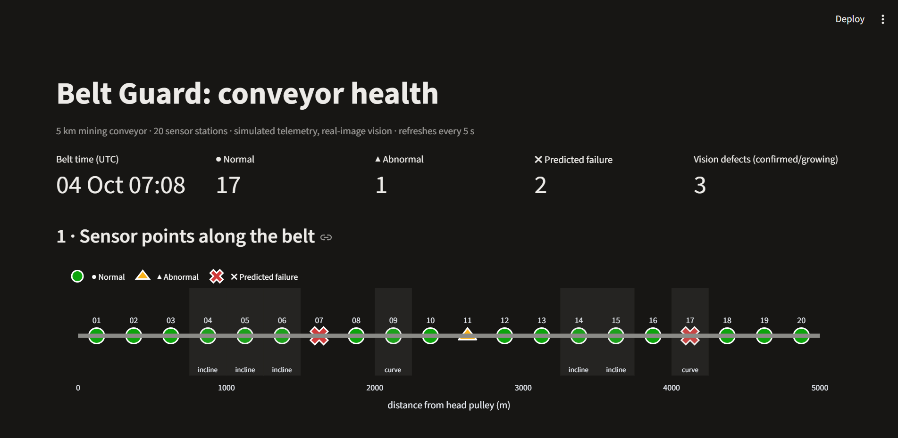
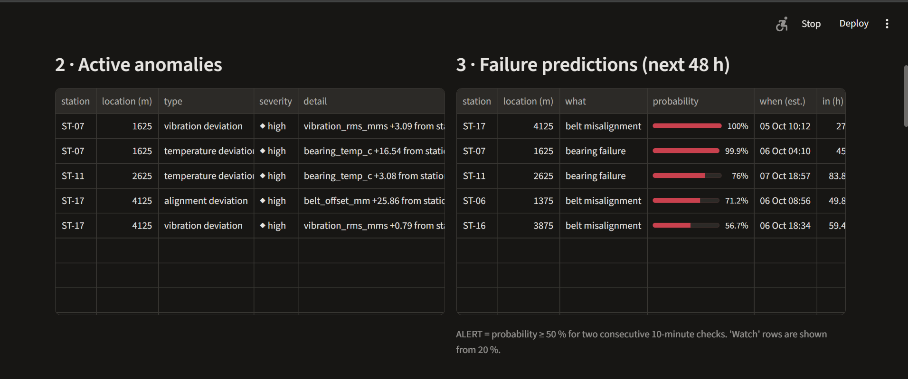
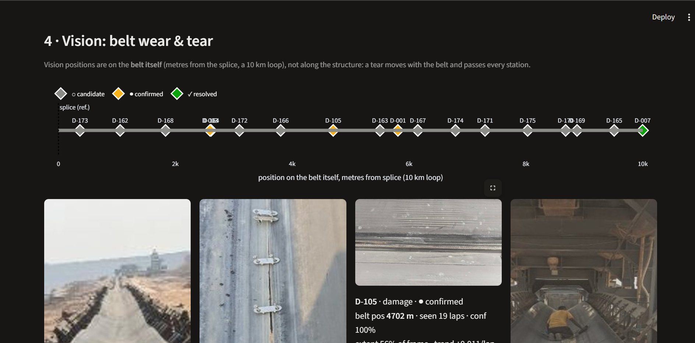
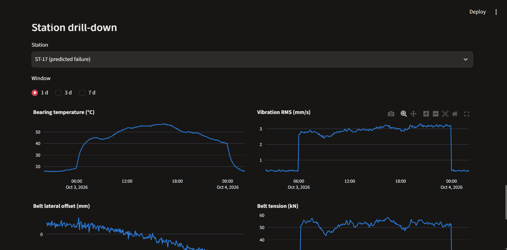

# Belt Guard

Monitoring a 5 km mining conveyor belt and predicting failures before they happen. It runs end to end on one laptop: a sensor simulator feeds a backend, the backend runs anomaly detection and failure prediction, a vision component inspects the belt surface lap by lap, and a dashboard shows the result.

**Design document:** [docs/DESIGN.md](docs/DESIGN.md). It covers what is monitored, how and why, in more depth than this README.

| Component | Where | One-line summary |
|---|---|---|
| Sensor simulator | [simulator/](simulator/) | 20 stations, 9 signals each, five physically motivated fault modes, plus a layer that makes the data messy on purpose |
| Backend | [backend/](backend/) | FastAPI + SQLite. Validates, cleans and stores readings, re-cleans late data, and runs anomaly rules and the model every 10 min of belt time |
| Prediction model | [ml/](ml/) | Gradient boosting: *which* failure, *where*, and *how many hours* away, evaluated on a time-based split |
| Vision | [vision/](vision/) | ResNet18 patch classifier trained on real belt-damage photos, plus a loop-aware tracker that turns per-frame detections into tracked defects |
| Dashboard | [dashboard/](dashboard/) | Streamlit. Station status, active anomalies, predictions, vision defects, drill-downs |

---

## Contents
1. [How to run it](#1-how-to-run-it)
2. [Dashboard screenshots](#2-dashboard-screenshots)
3. [The approach](#3-the-approach)
4. [Design decisions and why](#4-design-decisions-and-why)
5. [Messy input](#5-messy-input)
6. [Results](#6-results)
7. [Vision dataset: source and why](#7-vision-dataset-source-and-why)
8. [The vision challenge: a continuous loop](#8-the-vision-challenge-a-continuous-loop)
9. [Tool vs. agent vs. skip](#9-tool-vs-agent-vs-skip)
10. [What I'd do differently](#10-what-id-do-differently)
11. [How I used AI](#11-how-i-used-ai)
12. [Assumptions](#12-assumptions)

---

## 1. How to run it

Python 3.12, CPU only, no GPU or cloud needed.

```bash
python -m venv .venv && .venv\Scripts\activate          # Windows (source .venv/bin/activate elsewhere)
pip install -r requirements.txt

python -m simulator.run history          # 60 days of training data -> data/train/  (~1 min)
python -m ml.train                       # trains the failure model -> ml/models/, ml/REPORT.md
python -m vision.train                   # needs the dataset in vision/dataset/ (see section 7)

python run_demo.py                       # backend + live simulator + vision loop + dashboard
```

Then open **http://localhost:8501** for the dashboard, or **http://localhost:8000/docs** for the API.

`run_demo.py` streams 3 days of backfill and then runs live at 60× speed. The live stream contains three planted faults so there is something to look at within minutes:
- a bearing failing at ST-07;
- misalignment on the ST-17 curve;
- an overload building at the ST-11 drive.

The failure model is committed, so `ml.train` is optional. The vision weights (~45 MB) are not committed, so `vision.train` is required for the vision part. Without them the demo runs without vision.

## 2. Dashboard screenshots

| | |
|---|---|
|  |  |
|  |  |

The four required views:
1. **Status of every sensor point.** The belt map is coloured *and* shaped by status, so it doesn't rely on colour alone: ● normal, ▲ abnormal, ✖ predicted failure.
2. **Active anomalies**, with location, type and severity.
3. **Predictions**: what will fail, where, and the estimated time to failure.
4. **Vision detections**: tracked defects on a separate 0–10 km *belt* axis, with the latest frame of each.

What the screenshots show, compared with what was planted in the demo:
- **ST-07 (bearing) and ST-17 (misalignment)** are both flagged as predicted failures with the correct failure mode.
- **ST-11** is flagged, but with the wrong mode (see section 6).
- **Vision** confirmed all three active planted tears: D-001 at 5,809 m, D-105 at 4,702 m (it appears mid-run), and one at about 2,594 m. The tear at 9,996 m, just before the splice, was tracked as one defect across the wrap-around and then correctly marked `resolved` after its planned repair.
- The grey diamonds are single-sighting `candidate`s. These are false positives the loop filters out, and none of them reached `confirmed`.

## 3. The approach

```
simulator ──HTTP batches──▶ backend ──▶ SQLite ◀── dashboard (polls every 5 s)
 (truth + messy layer)        │  clean → features → rules + model
                              │
vision loop ──per-lap results─┘  (camera sim → patch classifier → loop tracker)
```

**Simulator** ([simulator/](simulator/))
- 20 sensor stations, 250 m apart.
- Terrain matters: two drive stations, five inclines and two curves.
- Each station reports 9 signals once a minute: bearing temperature, vibration, belt speed, belt tension, lateral offset, load, motor current, ambient temperature and dust.
- Faults are scheduled randomly, more often on inclines and curves. Each fault degrades its signals gradually, on a realistic pattern, before failing at a known time. That time is the answer key, and it is never sent to the backend.
- The five fault modes:
  - bearing failure;
  - belt misalignment;
  - splice failure;
  - drive slip (drive stations only);
  - motor overload (drive stations only).

**Backend** ([backend/](backend/)). Three layers turn raw readings into status:
1. **Hard rules** based on ISO 10816 vibration zones and equipment limits. These catch anything that is dangerous right now.
2. **Fleet-relative deviation.** Each station is compared with the median of all stations at the same minute, and then with its own 7-day baseline. Weather, load and start/stop cycles affect every station together, so they cancel out and a station drifting on its own stands out. This one idea removed most false alarms.
3. **The prediction model** gives the probability of each failure mode within 48 h, plus hours to failure. An alert needs two 10-minute buckets in a row above 0.5, so a single blip doesn't page anyone.

A station's status is the worst that applies: `predicted_failure` > `abnormal` > `normal`.

**Vision** ([vision/](vision/))
- Each simulated lap, the camera sees the planted defects (real dataset photos) plus random intact sections.
- The classifier labels each frame.
- The loop tracker turns those frame-level detections into tracked defects (section 8).

## 4. Design decisions and why

| Decision | Why | Trade-off accepted |
|---|---|---|
| Simulate **summary features** (RMS vibration, temperature) once a minute, not raw kHz waveforms | Real condition-monitoring units report this. It keeps the data volume sane. | No spectral analysis, e.g. bearing defect frequencies |
| **Faults as gradual degradation with a known failure time** | Prediction is only meaningful if failure is preceded by signals, and the known time gives exact labels and lead times | Real faults are less tidy; the metrics are optimistic (section 6) |
| **Compare each station with the fleet median**, then with its own history | Ambient temperature, load and shutdowns move all stations together; subtracting the median leaves only what's specific to one station | A fault hitting *every* station at once would be hidden. Hard rules still catch that. |
| **Gradient boosting on hand-built trend features** rather than an LSTM | Small tabular data, trains in seconds, easy to inspect, and a strong baseline | Features have to be designed by hand |
| **Time-based train/test split** with a 48 h gap | A random split would leak the same fault's neighbouring minutes into the test set and inflate the scores | Fewer test events |
| **Evaluate per failure event** (was it caught, and how early) as well as per row | Operators care whether a failure was flagged and with how much warning, not about per-row accuracy | — |
| **Re-clean the last 2 h on every ingest** | Late, duplicated and out-of-order readings get fixed instead of being frozen in wrong | Some repeated work, which is cheap at this scale |
| **SQLite + FastAPI + Streamlit** | Zero infrastructure, so a reviewer can run it in one command | Not production scale; I'd use TimescaleDB, MQTT and a proper frontend there |
| **Patch classifier** rather than an object detector for vision | Fine-tunes on a CPU in a minute and fits a camera over a moving strip; the share of damaged tiles gives a rough size | No pixel-accurate extent |

## 5. Messy input

The simulator's messy layer ([simulator/messy.py](simulator/messy.py)) deliberately damages the clean data. The backend ([backend/cleaning.py](backend/cleaning.py), [backend/engine.py](backend/engine.py)) has a defence for each kind of damage:

| What goes wrong | How it's handled |
|---|---|
| Station offline for hours | Raised as a data-quality anomaly. It is never shown as "normal". |
| Sensor stuck on one value | A run of ≥ 15 identical non-zero readings is masked and flagged |
| Single-reading spikes | Hampel filter (rolling median ± 6 MAD, window 15) |
| Sentinel values (−999, 9999), out-of-range values | Physical range limits per signal |
| Missing fields / NaN | Short gaps (≤ 5 min) are interpolated; longer gaps stay missing, and the model sees a `missing_frac` feature |
| Clock drift (ST-13 drifts 40 s a day) | Per-station offset tracking, snapped to the 1-minute grid |
| Duplicates, out-of-order and late arrivals | Deduplicated on (station, timestamp); a rolling 2 h re-clean window |
| Malformed records | Validated per record at the API; bad records are rejected *with a reason*, and the rest of the batch is kept |
| Backend down | The simulator retries with exponential backoff (store-and-forward) |

Per-station rejection counts are shown in the dashboard's data-quality section, so bad sensors are visible rather than silently hidden.

## 6. Results

**Failure prediction** (full report: [ml/REPORT.md](ml/REPORT.md)). Trained on days 1–40 and tested on days 41–60, which the model never saw.

| Metric | Value |
|---|---|
| Test failures caught | **20 / 20** |
| Median warning before failure | **56 h** (range 23–96 h) |
| False alarms | 0.06 per station per day (about 1 a day across all 20 stations) |
| Failure mode correctly identified | 99.8 % of detected rows |
| Time-to-failure error | 8 h mean absolute error |
| Average precision (row level) | 0.90 |

These numbers are **optimistic**, and I'd rather say so than have a reviewer discover it:
- The faults come from my own simulator, so the model is learning patterns I wrote.
- Drive slip and motor overload occur only at the two drive stations. Training saw just one example of each, and the test period had none. You can see this in the screenshot. The planted ST-11 *motor overload* is flagged, but as a **bearing failure** (76%), because a rising bearing temperature is the closest pattern the model knows. The *where* is right and the *what* is wrong, which is exactly what too few training examples looks like.

The honest conclusion: the pipeline is correct (no leakage, event-level evaluation, debounced alerts). The absolute numbers say little about real-world performance.

**Vision** (full report: [vision/REPORT.md](vision/REPORT.md)). Intact vs. damage patches:

| Split | Accuracy | Damage recall | Damage precision | Patches |
|---|---|---|---|---|
| valid (used to pick the best epoch) | 0.96 | 0.88 | 1.00 | 24 |
| test (fully held out) | 0.93 | 0.75 | 1.00 | 14 |

With 4–8 damage examples per split, these numbers have wide error bars. The loop tracker is what makes the system usable despite a moderate per-frame recall: a defect missed in one lap is seen in the next.

## 7. Vision dataset: source and why

**Source:** [Belt Conveyor Damage Detection](https://universe.roboflow.com/internship-mul5c/belt-conveyor-damage-detection), Roboflow Universe, version 1, CC BY 4.0. It is exported in YOLOv8 format into `vision/dataset/`, which is not committed (download it from the link).

**Why this one:**
- **They are real conveyor belts.** Phone photos of torn and damaged belt rubber in the field, including tears repaired with mechanical fasteners. Most "crack" datasets on Kaggle show concrete or steel surfaces, which look nothing like a dusty rubber belt.
- **Damage regions are labelled.** That gives positives (crops around each box) *and* negatives cropped from the same photos away from the damage. So "intact" means the same belt, the same lighting and the same camera, and the classifier learns damage rather than learning "which photo is this from".
- **It is openly licensed and needs no approval.** Alternatives I looked at: BeltCrack on ScienceDB is closer to industrial footage but needs registration and a request; other Roboflow belt-tear sets are similar but smaller or less clearly licensed.

**Problems with it, and what I did:**
- **The public export has only 48 images** (34 train / 9 valid / 5 test), not the ~900 the project page suggested. I trained on it anyway, using heavy augmentation, a frozen backbone apart from the last block, and intact negatives. I'm reporting the small evaluation sets honestly rather than presenting the numbers as strong.
- **Its classes are called "15" and "16"**, which are leftover annotation IDs, and there is only one box of class "16". I merged them into a single `damage` class ([vision/data.py](vision/data.py)) rather than train a class from one example. So the system detects *damage*, not damage *type*.

**How the images become a belt:** [vision/run.py](vision/run.py) "installs" held-out test images at fixed positions on the simulated loop. On top of that it simulates:
- **tear growth:** each lap reveals more of the labelled damage, and the rest is blurred to look like intact rubber;
- **dust:** a haze on every frame, with about 8% of frames heavily dusted;
- **belt stretch and encoder slip;**
- **a repair** partway through the run;
- **15 intact frames per lap**, as a source of false positives.

## 8. The vision challenge: a continuous loop

The belt is a 10 km loop (5 km carrying side + 5 km return), so a camera sees every metre about every 42 minutes. These are the consequences I identified, and how [vision/tracker.py](vision/tracker.py) handles each one:

| # | Consequence of the loop | What the system does |
|---|---|---|
| 1 | **The same tear is seen every lap.** Naively that's an alert every 42 minutes, forever. | Each detection is tagged with a **position on the belt** (metres from a reference splice), not a time. Detections at the same belt position across laps become **one tracked defect**. |
| 2 | **Position wraps around.** 9,998 m and 3 m are 5 m apart. | All distances are measured around the loop. Position updates take the shorter way round. |
| 3 | **The belt stretches, and encoder error accumulates** over the lap, so it's worst just *before* the splice comes round again. | Positions are **normalised by each lap's measured splice-to-splice length**, which cancels stretch. The matching tolerance **grows with distance from the splice** (5 m + 0.1 %). |
| 4 | **One-off false positives** (dust, spilled ore, shadows) | New tracks are `candidate`s and need **3 sightings in 4 laps** to be `confirmed`. Here the loop *helps*: every lap is a free second opinion. The rule was chosen by Monte Carlo ([vision/tune_tracker.py](vision/tune_tracker.py)) over the measured per-frame rates: 2-of-3 confirmed ~4 fake defects per 40-lap run, 3-of-4 confirms ~0.02, and misses no real ones. The cost is ~2 h before a new tear is confirmed. |
| 5 | **Obscured frames** | A low-contrast frame counts as "couldn't see", not "defect gone", so dust can't make a real tear disappear. |
| 6 | **Damage grows** | Size trend over the last 5 laps → `growing`. This is wear *progression*, the vision side's own form of prediction. |
| 7 | **Repairs** | 5 clear misses in a row → `resolved` (with ~90 % per-frame recall, 3 was too few: real tears risked being "resolved" by chance) |
| 8 | **Two coordinate systems.** A tear moves with the belt; stations are bolted to the frame. A tear at belt position 1,830 m passes *every* station. | The dashboard shows defects on a separate belt axis, not pinned to a station. |

**A mistake I caught** (see section 11): my first tracker used a *symmetric* tolerance, on the reasoning that position error is largest at both ends of the loop. That's wrong. Error builds up from the splice re-sync, so it is smallest just *after* the splice and largest just *before* it. The planted defect at 9,996 m was being split into two tracks. Normalising by the measured lap length, plus a tolerance that grows from the splice, fixed it.

**Chosen not to solve:**
- **The underside of the belt.** One camera on the carrying side never sees the bottom cover. That would need a second camera and matching defects between the two.
- **True size.** I measure the share of damaged tiles, not millimetres. A calibrated line-scan camera with segmentation would be needed.
- **Finding the splice from images.** I assume a physical splice marker (RFID or magnetic) gives a reliable reference once per lap.
- **Position across the belt's width.** Only position along the belt is tracked.
- **Linking vision and sensors.** For example, a tear passing a station once per lap shows up as a periodic vibration spike there. This is feasible because both share belt time, but I didn't build it.

## 9. Tool vs. agent vs. skip

**Tools (built, deterministic):** cleaning, rules, fleet-relative statistics, the trained models and the loop tracker. Everything that decides whether to stop a mine is deterministic, repeatable and auditable, with thresholds I can test. An LLM in that path would add cost, latency and unpredictability for no gain in accuracy.

**Agent (designed for, not built):** the natural place for an LLM agent is *on top of* the API, for example:
- writing the shift handover ("ST-07 bearing: about 40 h left, replace it in tonight's 00:00–06:00 window");
- answering ad-hoc questions.

The REST endpoints are already shaped so they could be exposed directly as agent tools.

**Skipped, and why:**

| Skipped | Why |
|---|---|
| The LLM agent layer | Lowest value per hour. The detection system has to be right first. |
| Real-time message broker (MQTT/Kafka), auth, cloud deployment | Infrastructure that doesn't change the core logic; HTTP batches with retry show the same store-and-forward idea |
| Remaining-useful-life models across components (e.g. idlers over months) | Needs data spanning years. The 48 h horizon matches maintenance planning shifts. |
| Object detection / segmentation for vision | The dataset is too small to train a detector meaningfully; patch classification was the honest choice |
| React frontend | Streamlit covers the four required views; the effort went into the data and models instead |

## 10. What I'd do differently

- **Get real, or at least independent, failure data early.** Every sensor metric here is graded against a simulator I wrote. Even a public bearing run-to-failure dataset (e.g. NASA IMS or FEMTO) would test the bearing pipeline against physics I didn't design.
- **Choose the vision dataset with a closer look at the export.** I picked from the project page, which suggested ~900 images; the export has 48. With more time I'd combine two or three belt datasets and properly relabel damage types (tear, edge wear, cover wear, splice damage).
- **Model the drives separately.** Slip and overload exist only at 2 of 20 stations, so a single shared model barely learns them. A small drive-specific model, or physics rules (current per tonne), would serve them better.
- **Persist state across restarts.** Clock-alignment offsets and the tracker's state live in memory; a restart re-learns them.
- **Test from day one.** I validated by running the system and inspecting the output (and found real bugs that way, see below). Unit tests for the cleaning and tracker edge cases would have caught them sooner.
- **Calibrate alert thresholds on cost.** 0.5 was chosen by inspection. A missed belt failure costs far more than an inspection, so the threshold should come from that cost ratio.

## 11. How I used AI

I built this with **Claude Code** (an AI coding assistant). The full session transcripts are in [ai_usage/](ai_usage/), and [ai_usage/README.md](ai_usage/README.md) summarises the key decisions. How the work was split:
- **Me:** the brief and its scope, the decisions (dataset choice, what to skip), and checking results against what should physically happen.
- **The assistant:** most of the code. I asked it to explain every change ([docs/CODE_EXPLAINED.md](docs/CODE_EXPLAINED.md) is that explanation) so that I understand and can defend each part.

Where the first answer was wrong and had to be overridden. Each of these was caught by running the system and questioning results that didn't look physical:

| What looked wrong | Root cause | Fix |
|---|---|---|
| 103k "stuck sensor" readings, far too many | The dust signal saturated at exactly 1.0, which looked like a stuck sensor | Physical dust model capped below saturation; the stuck rate was re-tuned |
| Tension and speed anomalies at every nightly shutdown | Deviation-from-baseline logic ran while the belt was stopping | Deviation checks only when running steadily; minimum *physical* deviation thresholds |
| ST-07 flagged **high severity** right after its bearing was replaced | It ran *cooler* than its old baseline, and the check was two-sided | Temperature and vibration deviations are one-sided: only hotter or shakier is a risk |
| A tear near the splice split into two tracks | Wrong reasoning about where encoder error peaks (section 8) | Normalise by measured lap length; tolerance grows from the splice |
| Vision timestamps at 1970 | The vision loop started before the sensor backfill set the clock | Wait for the backend's belt time and stamp each lap with it |
| A defect "confirmed" at 7,030 m, where nothing was planted | ~31 % of intact frames were flagged, and with 2-of-3 confirmation two random false positives sometimes landed close together | Measured per-frame rates, simulated the rules ([vision/tune_tracker.py](vision/tune_tracker.py)), moved to 3-of-4 confirmation |
| Dashboard showed defects already resolved | The backend appended vision updates instead of replacing them | Each vision update replaces the defect table |

## 12. Assumptions

The brief left these open, so I chose and recorded them:
- **Belt:** 5 km long (a 10 km loop), 4 m/s.
- **Stations:** 20 sensor stations every 250 m, one reading per station per minute.
- **Duty cycle:** runs 06:00–24:00, matching the 18 h/day in the brief.
- **Failure:** an event forcing an unplanned stop. Afterwards the component is replaced and the station is healthy again.
- **Vision:** one inspection camera on the carrying side, with a splice reference marker.
- **Time:** all timestamps are UTC.
